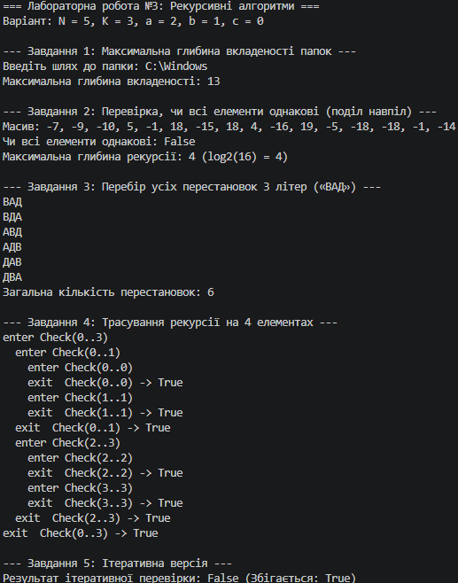

N = 5, K = 3, a = 2, b = 1, c = 0

## Базові випадки рекурсивних функцій
1. **Завдання 1 (Обхід папок):** Неявний базовий випадок — папка не містить підпапок (або до них немає доступу), через що цикл по підпапках не виконується жодного разу і функція повертає поточну глибину.
2. **Завдання 2 (Поділ навпіл):** Ліва та права межі збігаються (`lo == hi`), тобто розглянуто масив з одного елемента, який за визначенням є однаковим із самим собою (повертає `true`).
3. **Завдання 3 (Перестановки):** Поточний індекс досяг останнього елемента масиву (`index == chars.Length - 1`), що означає завершення формування однієї перестановки та її вивід на екран.

## Трасування (Завдання 4)
```text
enter Check(0..3)
  enter Check(0..1)
    enter Check(0..0)
    exit  Check(0..0) -> True
    enter Check(1..1)
    exit  Check(1..1) -> True
  exit  Check(0..1) -> True
  enter Check(2..3)
    enter Check(2..2)
    exit  Check(2..2) -> True
    enter Check(3..3)
    exit  Check(3..3) -> True
  exit  Check(2..3) -> True
exit  Check(0..3) -> True
Рядки exit з'являються у зворотному порядку до enter, оскільки виклики функцій зберігаються у системному стеку викликів за принципом LIFO (Last In, First Out). Функція може завершити виконання та повернути значення лише після того, як повністю завершаться всі її вкладені виклики.
```
## Відповіді на питання (Завдання 5)
1. Який запис зрозуміліший для цієї задачі?
Для визначення однаковості елементів у масиві значно зрозумілішим та ефективнішим є циклічний запис, оскільки він послідовно порівнює елементи та припиняє роботу при першій невідповідності без накладних витрат на рекурсивні виклики. Рекурсивний поділ навпіл у цій задачі потрібен лише для демонстрації принципу «розділяй і володарюй».

2. Чому переписати циклом Завдання 1 складніше?
Обхід вкладеної структури папок має невизначену глибину та кількість розгалужень, які звичайний цикл не здатний відстежувати послідовно. Щоб реалізувати ітеративний обхід папок, доведеться вручну створити та підтримувати стек або чергу (наприклад, Stack<string>), куди зберіганкуватимуться невідвідані директорії, тобто вручну моделювати системний стек викликів.

## Таблиця крайових випадків
| Вхід | Завдання | Очікувано | Отримано |
| --- | --- | --- | --- |
| Порожня папка | 1 | Глибина 0 | 0 |
| Папка, до якої немає доступу | 1 | Пропуск папки без винятку | Коректно пропущено (UnauthorizedAccessException caught) |
| Масив з одного елемента | 2 | `true` | `true` |
| Усі елементи однакові | 2 | `true` | `true` |
| Варіантів не існує (не застосовується) | 3 | Вивід відсутній / 0 | 6 перестановок виведено |

##
