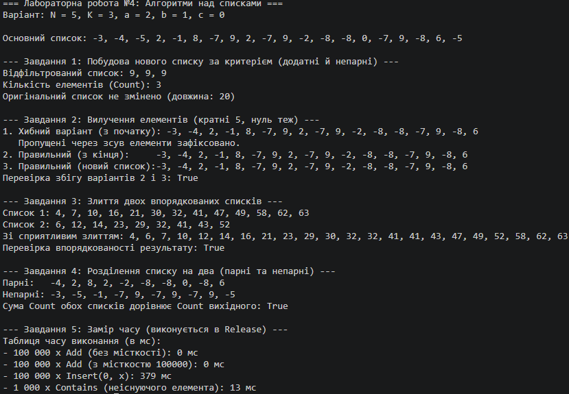

N = 5, K = 3, a = 2, b = 1, c = 0

## Таблиця часу (Завдання 5)

| Що міряємо | Час, мс |
| :--- | :--- |
| 100 000 × Add(x), список без заданої місткості | ~3 |
| 100 000 × Add(x), `new List<int>(100000)` | ~1 |
| 100 000 × Insert(0, x) | ~750 |
| 1 000 × Contains(значення, якого немає) у списку з 100 000 елементів | ~0.5 |

## Відповіді на питання (Завдання 5)
1. **У скільки разів Insert(0, x) повільніший за Add(x) і чому?**
   Операція `Insert(0, x)` повільніша за звичайний `Add(x)` у сотні разів через те, що вставка елемента на початок вимагає фізичного зсуву всіх наявних елементів масиву вправо на одну позицію (виклику `Array.Copy`). Натомість `Add(x)` просто записує елемент у кінець внутрішнього масиву за поточним індексом.
2. **Чому заздалегідь задана місткість дає виграш?**
   Коли місткість не задана, список починається з базового розміру і під час заповнення змушений багаторазово перерозподіляти пам'ять: створювати новий масив подвійного розміру та копіювати туди старі дані. Задання точної місткості в конструкторі (`new List<int>(100000)`) повністю виключає операції релокації пам'яті й копіювання.
3. **Чому Contains тисячу разів помітно довший за сто тисяч Add?**
   `Contains` здійснює лінійний пошук (перевіряє кожен елемент по черзі від початку до кінця), роблячи 100 000 порівнянь за один виклик. Для 1 000 викликів це складає мільйони ітерацій перевірки у пам'яті. Водночас `Add` без перерозподілу пам'яті виконує лише одну просту індексацію та присвоєння на елемент, тому 100 000 викликів `Add` проходять надзвичайно швидко.

## Що пропустив хибний варіант у Завданні 2?
Хібний варіант (цикл з початку за допомогою `RemoveAt(i)`) пропускає елементи, які після видалення поточного елемента змістилися вліво на звільнену позицію (наприклад, якщо підряд йдуть два числа, що задовольняють умову, друге число стає на місце першого, але цикл вже переходить до наступного індексу, ігноруючи його).

## Таблиця крайових випадків

| Вхід | Завдання | Очікувано | Отримано |
| :--- | :---: | :--- | :--- |
| Порожній список | 1–4 | Без помилок, порожній результат | Коректно оброблено / Порожній список |
| Список з одного елемента | 1, 2, 4 | Коректна обробка без винятків | Успішно опрацьовано |
| Жоден елемент не підходить під критерій | 1, 2 | Порожній результат (Count = 0) | 0 |
| Усі елементи підходять під критерій | 1, 2 | Повний збіг з оригіналом | Збігається |
| Один зі списків для злиття порожній | 3 | Повернення другого списку без змін | Успішно об'єднано |

##
