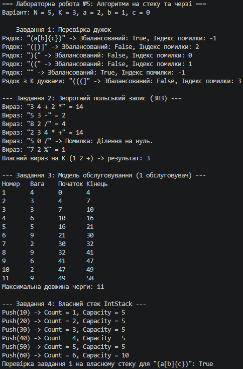

N = 5, K = 3, a = 2, b = 1, c = 0

## Результати тестів (Завдання 1 та 2)
- **Завдання 1 (Дужки):**
  - `"(a[b]{c})"` -> збалансований
  - `"([)]"` -> незбалансований
  - `")("` -> незбалансований
  - `"(("` -> незбалансований
  - `""` -> збалансований
  - Свідомо незбалансований рядок з $K=3$ відкривальними дужками (`(((]`): повернув `isBalanced = false`, індекс помилки `3`.
- **Завдання 2 (ЗПЗ):**
  - `"3 4 + 2 *"` -> 14
  - `"5 3 -"` -> 2
  - `"8 2 /"` -> 4
  - `"2 3 4 * +"` -> 14
  - `"5 0 /"` -> Повідомлення про помилку (ділення на нуль)
  - Власний вираз на $K=3$: `"1 2 +"` -> результат: 3

## Вивід Count і Capacity (Завдання 4)
Початкова місткість = 5. Перевірка після 6 викликів Push:
- Push(10) -> Count = 1, Capacity = 5
- Push(20) -> Count = 2, Capacity = 5
- Push(30) -> Count = 3, Capacity = 5
- Push(40) -> Count = 4, Capacity = 5
- Push(50) -> Count = 5, Capacity = 5
- Push(60) -> Count = 6, Capacity = 10 *(відбулося подвоєння)*

## Обґрунтування (Завдання 5)
1. **Завдання 1 (Збалансованість дужок):** Використовується **стек**, а не список, оскільки остання відкрита дужка має закриватися першою (принцип LIFO). Якби взяли список, довелося б вручну шукати та видаляти елементи зсередини, порушуючи послідовність вкладеності.
2. **Завдання 2 (Зворотний польський запис):** Використовується **стек**, оскільки оператори застосовуються до двох останніх попередньо введених операндів. У списку порядок збереження та вилучення останніх елементів не підтримувався б природним чином.
3. **Завдання 3 (Модель обслуговування):** Використовується **черга**, оскільки заявки мають обслуговуватися за принципом FIFO (першим прийшов — першим обслуговується). Якби взяли стек, заявка, що надійшла останньою, обслуговувалася б першою (LIFO), що суперечить логіці житлової черги.
4. **Чому Queue.Dequeue() дешевший за List.RemoveAt(0)?**
   Як показано в Лабораторній роботі №4, `List.Insert(0, x)` та аналогічне видалення `RemoveAt(0)` вимагають фізичного зсуву всіх 100 000 елементів масиву в пам'яті (дорога операція копіювання). Натомість стандартна `Queue<T>` реалізована на кільцевому буфері (або з індексом початку, що зсувається), де `Dequeue` просто змінює індекс першого елемента й обнуляє посилання без жодного зсуву масиву, виконуючись за лінійний час $O(1)$.

## Таблиця крайових випадків

| Вхід | Завдання | Очікувано | Отримано |
| :--- | :---: | :--- | :--- |
| Порожній рядок | 1, 2 | Збалансовано / Порожній вираз | Коректно оброблено |
| Рядок без жодної дужки | 1 | Збалансований (індекс −1) | Збалансований |
| Вираз з одного числа | 2 | Повернення числа / помилка формату | Успішно повернено число |
| Ділення на нуль | 2 | Повідомлення про помилку, не падіння | Перехоплено, виведено повідомлення |
| Жодної заявки | 3 | Коректне завершення моделі | Оброблено без помилок |
| Pop на порожньому стеку | 4 | Виняток InvalidOperationException | Викинуто виняток |

##
